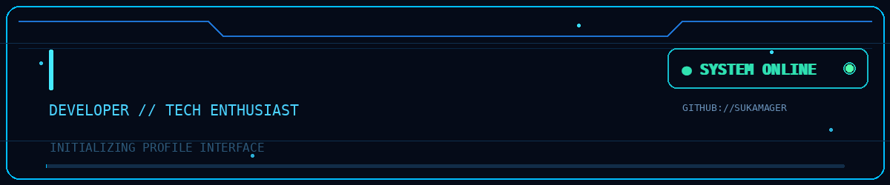
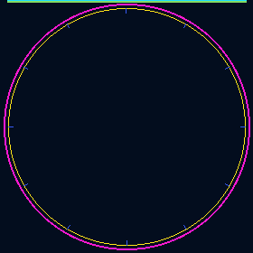

<div align="center">





### `> HELLO, WORLD!`
**Student • Developer • Tech Enthusiast**

*Always learning, always building, always exploring technology.*

[](https://instagram.com/_ilulmagerbgt) [](https://tiktok.com/@ilulsukamager) [](https://x.com/ilulsukamager) [](https://youtube.com/@ilulsukamager)


</div>

---

## `01 // TECH ARSENAL`

<p align="center">


</p>

## `02 // GITHUB ANALYTICS`

<div align="center">


</div>

## `03 // TROPHY ROOM`

<div align="center">


</div>

## `04 // CONTRIBUTION MATRIX`

<div align="center">


</div>

## `05 // ARCADE ZONE`

<div align="center">

**PAC-MAN — collecting contribution dots**

<picture>
  <source media="(prefers-color-scheme: dark)" srcset="https://raw.githubusercontent.com/sukamager/sukamager/output/pacman-contribution-graph-dark.svg">
  <source media="(prefers-color-scheme: light)" srcset="https://raw.githubusercontent.com/sukamager/sukamager/output/pacman-contribution-graph.svg">
  
</picture>

**SNAKE — tracing the contribution trail**


</div>

---

<div align="center">

```text
> CONNECTION: ESTABLISHED
> STATUS: LEARNING / BUILDING / REPEATING
> MISSION: TURN IDEAS INTO REAL PROJECTS
```

**Thanks for visiting my profile!**

<sub>Designed with ⚡ and a little bit of code.</sub>

</div>
